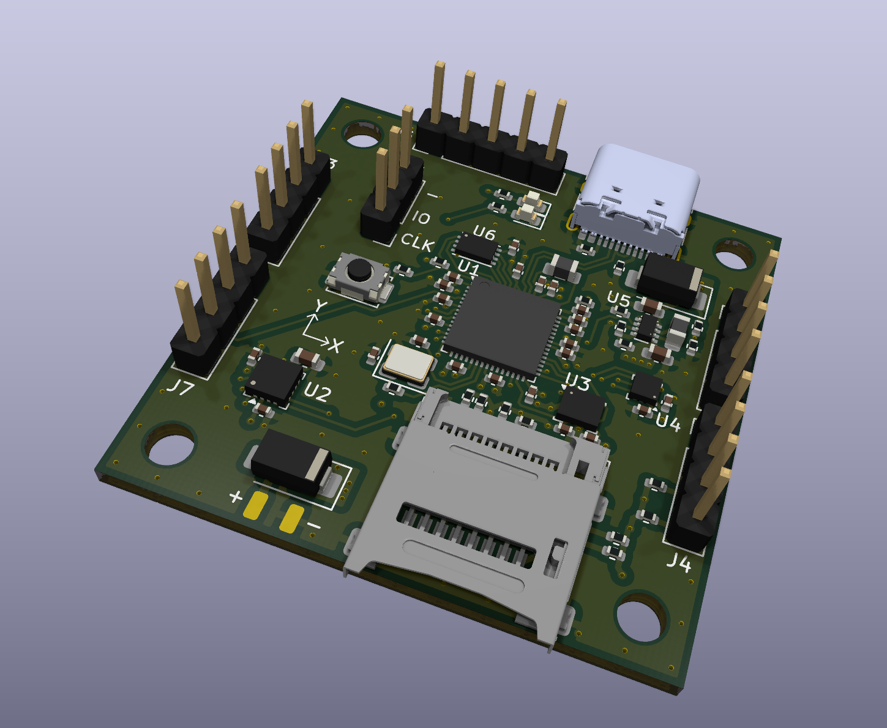
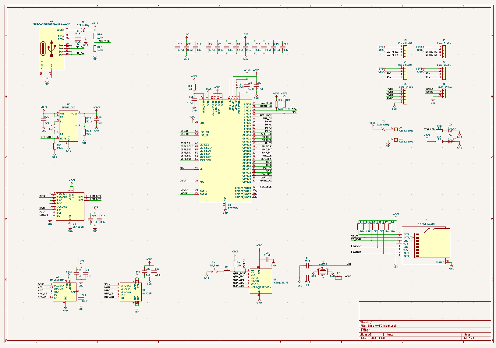
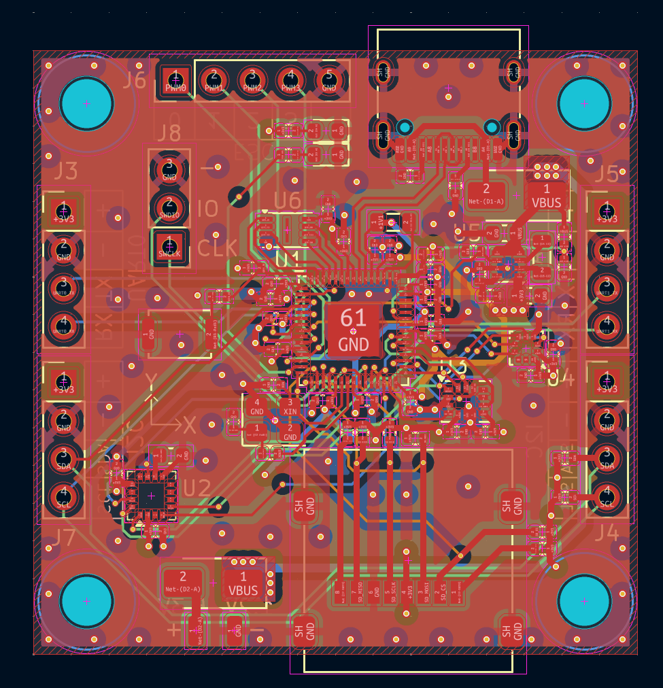

# Simple-FC

A RP2350 based flight controller with a 10-axis IMU. This board is designed to be used for drones and had four PWM outputs to control ESCs as well as UART and I2C to communicate with other boards.

## Overview
- **MCU**: RP2350
- **Gyroscope/Accelerometer**: LSM6DSM
- **Magnetometer**: MMC5983MA
- **Barometer**: BMP384
- **External Storage**: Micro SD card
- **MCU Storage**: 16MB
- **Input Voltage**: 1.2V-5.3V
- **I/O**: 
    - 4 PWM
    - 2 UART
    - 2 I2C
    - USB C

### Schematic

### PCB

## BOM
The BOM is located in BOM.csv and DigiKeyBOM.csv for ordering the parts from DikiKey. Alternatively the DigiKey BOM can be found [here](https://www.digikey.com/en/mylists/list/84RC15SOU8).
